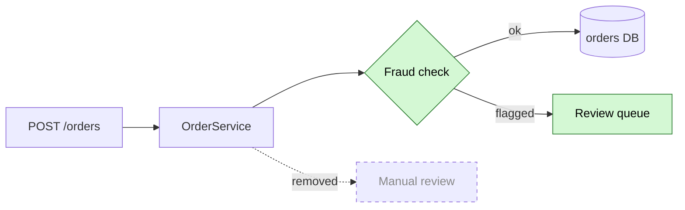

# PR description

A PR description gives the reader a map, not a copy of the code. They should
know what the branch does in a few seconds, and know where to start reading.
The code is in the diff. Do not describe it again.

If the `simplified-technical-english` skill is installed, use it to word the
body.

The agent path needs the GitHub CLI (`gh`), signed in to the repo's host. If
`gh` is not available, use the manual path (step 7b).

## 1. Ask who fills the PR

Before you do anything else, ask the user:

- **Agent fills it** — you open the PR or update the existing one (step 7a).
- **I fill it** — you give them a markdown block to copy (step 7b).

Skip the question if the request already answers it: "open the PR for me" or
"update #1234" means agent; "just give me the text" or "I'll paste it" means
manual. Accept any clear answer ("you do it", "go ahead", "agent", "me",
"I'll do it", "manual").

## 2. Inspect the branch

Do not guess. Look at the actual changes on the branch.

1. Find the PR: the one the user names, or the open PR on this branch. Read
   its body too. Step 4 builds on it, so nothing the author wrote gets lost:

   ```sh
   gh pr view [<n>] --json number,url,title,body,baseRefName
   ```

   No PR is fine: the command fails, and you write a new body.

2. Get the diff. With a PR, use `gh pr diff <n>` and its `baseRefName`.
   Without one, compare against the default branch on the remote, not a
   stale local copy:

   ```sh
   base=$(gh repo view --json defaultBranchRef -q .defaultBranchRef.name)
   git fetch origin "$base"
   git --no-pager diff "origin/$base...HEAD" --stat
   git --no-pager log "origin/$base..HEAD" --oneline
   ```

3. Read the changed files only to understand intent and to find the entry
   point: where data enters the changed code (an API endpoint, an event
   consumer, a job, a UI component, a CLI command).

4. If the branch name, a commit, or the user names a ticket (e.g. a Jira key
   like `ABC-123`), mention it in the Summary. Do not invent a link.

## 3. Look for the repo's PR template

If the repo has its own template, use it instead of the default in step 6.

1. Look for it (GitHub ignores case in the name):

   ```sh
   git ls-files | grep -i 'pull_request_template'
   ```

   It can be `.github/`, the repo root, `docs/`, or a
   `PULL_REQUEST_TEMPLATE/` folder with more than one template. For a
   folder, pick the one that fits the change, or ask the user.

   If the repo has none, GitHub uses a default template from the org's
   `.github` repo, but only if that repo is public. Look in all of it (root,
   `.github/`, `docs/`) the same way:

   ```sh
   gh api repos/<org>/.github --jq .visibility    # "public", or GitHub ignores it
   gh api "repos/<org>/.github/git/trees/HEAD?recursive=1" --jq '.tree[].path' \
     | grep -i 'pull_request_template'
   ```

   If the `.github` repo is not public, or the command fails, the org has no
   default template. Read a match with
   `gh api repos/<org>/.github/contents/<path> -H 'Accept: application/vnd.github.raw'`.

2. If you find no template, use the default template in step 6.

3. If you find one, keep its headings and their order. Then fill it with the
   content from step 4:

   - **Summary first.** The first paragraph of the body must be the Summary.
     Put it in the template's first description section (often "Description",
     "What", or "Context"). If the template does not start with one, add
     `## Summary` above the template's first section.
   - **Flow and reading order.** Put them in the section that fits, e.g.
     "Changes" or "How to review". If no section fits, add `## Flow` and
     `## How to read this PR` after the Summary.
   - **Template-only sections** (testing steps, screenshots, checklists):
     fill them in short and true. Do not tick a box you did not check. Write
     "N/A" for a section that does not apply. Do not delete it.
   - **Comments in the template** (`<!-- ... -->`): follow them, then delete
     them.
   - Use the template's structure, but keep the content short. A long
     template is not a reason to write more.

## 4. Write it

Stay high level. The reader wants the idea, not the implementation.

- Short sentences. Plain words. Active voice.
- No filler. No marketing. No restating the title.
- Name components and steps, not functions, variables, or line numbers.
- If it is not needed to follow the flow, leave it out.

If the PR already has a body (step 2), start from it, not from a blank
template. Write or replace only the Summary, Flow, and How to read this PR.
Keep every other section and any text the author wrote by hand, word for
word. Fill a template section only if it is still empty or a placeholder.

### Summary

Two or three sentences. What does this branch change, and why? A reader who
stops here should still know what the PR does. If there is a migration, a
breaking change, or a feature flag, say so here in one sentence.

### Flow

One Mermaid diagram of the logic or data flow after the change.

- Start at the entry point. End where the data lands (DB, queue, external
  API, response).
- Keep it small: about 8 nodes or fewer. Collapse steps that did not change.
- Mark what is new or changed with the `:::new` class.
- If the change replaces an old path, draw the old step with a dashed edge
  (`-.->|removed|`) and the `:::old` class. Do not draw two full diagrams.
- Skip the diagram when there is no flow to show: docs, config, a rename, a
  dependency bump.
- Follow the rules in step 5, or the diagram shows as an error box.

### How to read this PR

An ordered list of files, in the order the data moves through them. Start at
the entry point and go deeper.

- One line per file: the role it plays in the flow. Not what each line does.
- Group small support files (types, fixtures, wiring) into one last line.
- Put tests last, or leave them out if they only mirror the code.

## 5. Make the diagram render

GitHub renders a fenced ` ```mermaid ` block as a diagram in PR bodies and
comments. It draws it in the reader's theme, light or dark, and shows a parse
error in place of the diagram if the syntax is wrong. These rules come from
real failures:

| Rule | Why |
|---|---|
| Fence it as ` ```mermaid `, not ` ```mmd ` or indented | Only `mermaid` triggers the renderer |
| Set `color:#000` in every `classDef` with a light `fill` | Dark theme uses light text; without it, the label vanishes on the light fill |
| Quote labels with `( ) [ ] { } /` or `end`: `A["Check (new)"]`, `A["POST /orders"]` | Unquoted brackets are a parse error; a label that starts with `/` is read as a shape |
| Write a `"` inside a label as `#quot;` | A bare `"` is a parse error, or dropped inside a quoted label |
| Never name a node `end`; use `done` or `End` | `end` is a keyword and breaks the parse |
| Show removed steps with a dashed edge, not `~~text~~` | Strikethrough prints the tildes as text |

If Node is available and the diagram is not trivial, check that it parses
before you hand it back. It reads stdin and writes no file (the first run
downloads a headless browser). Exit code 0 means it parses:

```sh
npx -y @mermaid-js/mermaid-cli -i - -o - -e svg > /dev/null <<'MMD'
flowchart LR
  ...
MMD
```

## 6. Default template

Use this only if the repo has no PR template (step 3).

````markdown
## Summary

<Two or three sentences. What changes, and why.>

## Flow



## How to read this PR

1. `path/to/controller.ts` — entry point; accepts the new field.
2. `path/to/service.ts` — calls the fraud check before it saves.
3. `path/to/fraud-check.ts` — new; decides ok or flagged.
4. `path/to/review-queue.ts` — new; sends flagged orders to review.
5. Types, wiring, and tests in `path/to/...`.
````

## 7a. Agent fills it

1. Write the body to `pr-description.md` in the git directory, and show it to
   the user. Git never commits files there, so the draft stays out of the
   branch. Get the directory with `git rev-parse --git-dir` (usually `.git`;
   a worktree has its own) and use the full path in the commands below.
2. Ask before you post: "Update PR #n?" for the PR from step 2, or "Open a
   new PR titled <title>?" Suggest the title from the Summary. Accept any
   clear yes ("yes", "go ahead", "update it", "open it"). Do not post without
   one: everyone with access to the repo can read the body.
3. Before an update, read the body again (`gh pr view <n> --json body`). If
   it changed since step 2, merge the new text into the draft first.
   `gh pr edit` replaces the whole body; it does not merge.
4. Apply with the body file, never an inline `--body`. Shell quoting breaks
   the backticks in the Mermaid fence:

   ```sh
   gh pr edit <n> --body-file <git-dir>/pr-description.md           # existing PR
   gh pr create --title "<title>" --body-file <git-dir>/pr-description.md
   ```

5. Give the user the PR URL.

## 7b. User fills it

1. Print the whole body in one ` ````markdown ` block (four backticks), ready
   to copy. The body has its own ` ```mermaid ` fence inside, and three
   backticks would close the block early.
2. Tell the user that GitHub renders the diagram when they paste the body
   into the PR. They do not need an image. If the PR already had a body, the
   block includes it (step 4), so they can replace the whole body with it.

## 8. Checklist

- [ ] You asked who fills the PR, or the request already answered it.
- [ ] If the PR already had a body, every hand-written section is still in it.
- [ ] If the repo has a PR template, the body uses its sections in its order.
- [ ] The first paragraph is the Summary. It alone tells the reader what the
      PR does. Keep it simple, 2-3 sentences is enough.
- [ ] The diagram shows the flow, not the code. New parts are marked.
- [ ] The diagram follows the rules in step 5.
- [ ] The file list follows the data, from entry point down.
- [ ] Nothing in the body restates what the code already says.
- [ ] Every claim is grounded in the diff. No invented detail.
- [ ] A reviewer can read it in under 30 seconds.
